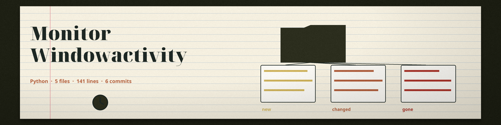

# monitor-windowactivity
Logs active window titles and processes, providing a timeline of user activity on the system. Each entry in the output file carries a timestamp, a new entry is written only when the active window title and owning process pair changes, and the previous entry is closed with an end line giving its duration. - Focused on System monitoring and alerts

Supported platforms, and the provider each one needs: Windows uses ctypes (part of the standard library) for the foreground window lookup and psutil for the owning process. macOS uses the Quartz module (from pyobjc) for the window list and psutil for the owning process. Linux uses the Xlib module (python-xlib) for the X11 foreground window and psutil for the owning process. If no provider is available on the machine, the tool prints a line naming the missing platform support and exits 1 at startup; it never records its own process instead.

## Install
`git clone https://github.com/ShadowStrikeHQ/monitor-windowactivity`

## Usage
`python3 main.py [params]`

## Parameters
- `-h`: Show help message and exit
- `-i`, `--interval`: Interval (in seconds) between checks (default: 5). Must be positive; an invalid value exits 1.
- `-o`, `--output`: Output log file (default: window_activity.log). A path containing two dots exits 1.
- `-v`, `--verbose`: Enable verbose logging (debug level).

## License
Copyright (c) ShadowStrikeHQ
